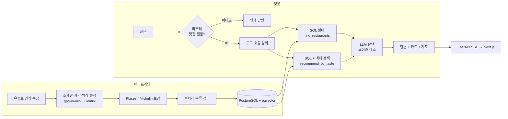

# 맛집 추천 RAG 챗봇

미식 유튜브 영상의 소개란·자막·영상 본편에서 식당 정보를 추출해 DB에 쌓고, 그 위에서 "강남역 근처 일식집", "흑백요리사 셰프가 하는 식당"처럼 자연어로 맛집을 찾아 주는 챗봇입니다. 국내·해외 식당을 모두 다룹니다.

- **데이터 파이프라인**: 영상 수집 → 식당·메뉴 추출 → Google Places·Michelin 보강 → PostgreSQL 적재
- **하이브리드 검색**: SQL로 조건(지역·영업·미슐랭)을 먼저 좁히고, 벡터 검색과 LLM 판단으로 취향에 맞는 식당 선별
- **서비스**: LangGraph 에이전트 + FastAPI(SSE) + Next.js (카드·지도·영상 타임라인)

> 실행에는 각자의 API 키와 DB가 필요합니다(데이터는 저장소에 포함하지 않습니다).

## 프로젝트 소개와 역할

SeSAC 서초캠퍼스 *LLM Agent를 활용한 서비스 기획 및 제작 과정*의 최종 프로젝트입니다. 2인 팀으로 2026-09-21~10-12(약 3주) 진행했고, 종료 후 개인 확장으로 챗봇과 웹 서비스까지 이어서 구현했습니다.

| 구분 | 기간 | 내용 | 담당 |
|---|---|---|---|
| 팀 프로젝트 | 9/21~10/12 | 영상 수집·필터링, 제작자 자막 기반 식당·메뉴 추출, Places·미슐랭 보강, DB 설계·적재(데이터 관련 작업 전체) | 본인 |
| 팀 프로젝트 | 9/21~10/12 | 챗봇, HeyGen LiveAvatar 기반 음성 아바타 UI | 팀원 |
| 개인 확장 | 10/13~ | Gemini 영상 분석으로 자동 생성 자막 영상까지 확장, 챗봇 에이전트(LangGraph), 평가셋, Streamlit → FastAPI(SSE) + Next.js 웹, n8n 자동화 | 본인 |

개인 확장의 챗봇은 팀 프로젝트와 같은 DB를 쓰지만 별도로 구현한 것이며, 두 챗봇의 성능을 비교한 기록은 없습니다(팀 프로젝트에는 정량 평가가 없었습니다). 음성 아바타는 외부 유료 서비스(HeyGen)가 필요해 개인 확장에는 넣지 않았고 텍스트 채팅만 지원합니다.

## 데이터 규모 (2026-10-19, DB 기준)

| 항목 | 값 |
|---|---|
| 식당 | 206곳 (국내 85·해외 121, 중국 본토 제외) |
| 영상 | 185개 (영상 분석 노트가 있는 영상 140개) |
| 메뉴 | 1,491개 (음식 1,208·음료 283) |
| 벡터 청크 | 1,454개 (OVERVIEW 167·FOOD 1,043·DRINK 195·CHEF 49) |
| 미슐랭 조회 | 163곳 (43곳은 API 크레딧 한도로 미조회) |
| 챗봇 평가셋 | 46문항 |

## 주요 기능

- 자연어 질문으로 지역·음식 종류·미슐랭 등급·영업 여부·가격대 조건 검색 ("제주도 맛집", "한강 근처 미슐랭", "지금 문 연 곳")
- 취향·메뉴·셰프 경력 같은 비정형 질문은 벡터 검색 + LLM 판단 ("흑백요리사에 나온 셰프의 식당")
- 없는 음식이면 억지로 추천하지 않고 "없다"고 답변
- 답변 스트리밍(SSE), 추천 식당 카드, 조건에 맞는 전체 식당을 찍은 지도, "더 보여줘" 이어 조회
- 식당 상세 팝업: 영상 속 메뉴 타임라인(메뉴를 누르면 그 시각으로 이동해 재생), 영업시간, 위치 지도

## 아키텍처



| 구분 | 데이터 | 저장소 | 조회 |
|---|---|---|---|
| 정형 | 영업시간, 위치, 평점, 가격대, 미슐랭 등급, 분류 | PostgreSQL | SQL |
| 비정형 | 분위기, 음식 스타일, 메뉴 설명, 셰프 경력, 영상 속 특징 | pgvector | 벡터 검색 |

## 기술 스택

| 영역 | 사용 기술 |
|---|---|
| 언어·도구 | Python 3.14, uv, TypeScript |
| LLM·에이전트 | LangGraph, LangChain, LangSmith, OpenAI(`gpt-4o-mini`, `text-embedding-3-small`), Gemini |
| 외부 데이터 | Google Places API (New), Michelin Guide(Parse SDK), yt-dlp, OpenStreetMap Nominatim |
| DB | PostgreSQL, pgvector |
| 백엔드 | FastAPI (SSE 스트리밍, 연결 풀, 읽기 전용 DB 계정) |
| 프론트엔드 | Next.js 16 (App Router), React 19, Tailwind CSS 4, react-leaflet |
| 자동화 | n8n (Docker), 파이프라인 HTTP API |

## 설계 포인트와 해결한 문제

| 문제 | 해결 |
|---|---|
| 거리 임계값만으로는 "맞는 결과"와 "없는 결과"가 갈리지 않음 | SQL로 좁힌 뒤 벡터 후보를 LLM이 질문 충족 여부로 판단, 충족하는 후보가 없으면 "없다"고 답변 |
| 모델이 사용자가 말하지 않은 국가·지역 필터를 임의로 넣음 | 맛집 질문 여부를 먼저 판단하는 라우터 노드, 도구 호출 강제, 프롬프트 규칙 |
| 프롬프트에 규칙을 넣어도 모델이 지키지 못하고, 필드를 늘리면 추출이 흔들림 | 추출과 후처리 분리: 분류·평가어·코스 순서 보정은 코드로 처리하고 원본(`*_raw`)을 보존해 규칙이 바뀌어도 모델을 다시 호출하지 않고 재처리 |
| 자동 생성 자막은 오타·누락이 많음 | 제작자 자막은 자막 분석, 자동 자막은 Gemini 영상 분석으로 경로를 나누되 같은 JSON 구조로 맞춰 후처리·적재를 공유 |
| 미슐랭 판별이 실행마다 달라지고 다른 도시 지점이 섞임 | 검색 기반에서 Parse API로 교체, 이름·도시가 일치하는 후보만 채택, 영상 속 언급이 아니라 API 결과를 근거로 사용 |
| "타파스 바" 같은 음식 종류 질문이 안 잡힘 | 대분류/세부 분류 기준과 표기 통일 규칙을 세우고 후처리·적재 단계에 반영 |
| "제주도 맛집"이 0건 (지역 컬럼이 시·군 단위) | 도 이름을 소속 시·군으로 펼쳐 비교 |
| 셰프 경력 질문의 검색 순위가 낮음 (긴 개요 청크에 희석) | 셰프 이름·경력만 담은 짧은 CHEF 청크를 분리 (해당 식당 8위 → 1위) |
| "한강 근처"가 좌표 한 점 + 반경이라 청담 쪽 식당이 빠짐 | OpenStreetMap의 강 선 지오메트리와 식당 사이 최단 거리로 검색 |
| 외부 API 일일 한도(Places·Michelin 하루 100회) | 건별 저장과 중단 후 재개, 좌표 캐시, 429 재시도, 같은 식당은 1회만 호출 |
| 중복 적재와 BIGINT 범위 초과 | `google_cid`를 문자열로 저장해 중복 제거 기준으로 사용, 적재 스크립트는 여러 번 실행해도 중복되지 않게 구현 |
| 챗봇 서버의 DB 권한 | 읽기 전용 계정만 사용(쓰기 권한 환경변수는 프로세스에서 제거), 파이프라인 API는 API 키 인증 |

## 챗봇 평가

`src/chatbot/eval/`에 46문항 평가셋이 있습니다(정형 SQL·취향 RAG·없는 음식·식당 조회·잡담). 정답을 고정 목록이 아니라 DB에서 SQL로 계산하므로 데이터가 늘어도 유지됩니다.

- 초기 21/41 → 개선 후 지명 조회를 뺀 문항 100% (`--no-geo`)
- 이 점수는 **실패한 질문을 고친 뒤 같은 질문으로 잰 값**이라 새 질문에서는 낮을 수 있고, 일부 문항은 실행마다 편차가 있습니다.
- 정답 후보를 키워드로 만들어 재현율은 측정하지 못하며, 다중 턴 평가는 없습니다.

## 한계와 다음 단계

- 메뉴 환각·누락은 정답 기준이 없어 전수 검증하지 못했습니다.
- Gemini 영상 분석은 2026년 자동 자막 영상까지 적용했고, 2025년 23개·2024년 11개가 남았습니다.
- 웹은 로컬 데모입니다(인증·요청 제한 없음, 서버 재시작 시 대화 기억 소실, 대화 기록 미저장).
- n8n 자동화는 수동 자막 경로를 end-to-end로 확인했고 스케줄은 활성화하지 않았습니다.
- 벡터 검색(`recommend_by_taste`)은 후보 8개 안에서만 고르며 전체 건수·이어 조회를 지원하지 않습니다.

## 실행 방법

```bash
uv sync                                    # 의존성 설치
# .env 파일에 아래 환경변수를 작성
uv run python src/api/chat_server.py       # 챗봇 API  http://127.0.0.1:8000
npm --prefix web install && npm --prefix web run dev   # 웹  http://localhost:3000
uv run python src/chatbot/cli.py --trace "강남역 근처 일식집"   # 터미널 챗봇
uv run python src/chatbot/eval/run_eval.py --no-geo            # 평가셋
```

필수 환경변수(이름만): `OPENAI_API_KEY`, `GOOGLE_PLACES_API_KEY`, `MICHELIN_GUIDE_API_KEY`, `GEMINI_API_KEY`, `POSTGRES_URI`, `READONLY_POSTGRES_URI`. 전체 목록과 DB 구축·파이프라인 실행 순서는 [개발 문서](docs/DEVELOPMENT.md)를 봅니다. `data/`와 `.env`는 저장소에 포함되지 않으므로 DB를 새로 구축해야 챗봇이 동작합니다.

## 저장소 구조

```
src/
├── pipeline/   # 데이터 파이프라인: 수집, 추출, Places·Michelin 보강, 후처리, 영상 1개 자동 처리(process_video.py)
├── db/         # 스키마·마이그레이션 SQL, 적재 스크립트(load_*), 임베딩, RAG 검색(rag_search.py)
├── chatbot/    # LangGraph 에이전트(graph.py, tools.py), 지역·강 검색, 응답 변환, 평가셋(eval/)
└── api/        # chat_server.py(챗봇 SSE API), pipeline_server.py(n8n용 파이프라인 API)
web/            # Next.js 웹 UI
n8n/            # 자동화 워크플로우(Docker)
docs/           # 개발 문서 (파이프라인·DB·작업 기록)
```

## 문서

- [개발 문서](docs/DEVELOPMENT.md): 파일별 설명, 파이프라인 단계, DB 스키마, 실행 순서, 작업 기록, 알려진 이슈
- [RAG 설계](docs/RAG_DESIGN.md), [챗봇 API 설계](docs/CHATBOT_API_DESIGN.md), [미슐랭 판별 방식의 변천](docs/MICHELIN_HISTORY.md), [웹 UI](web/README.md)
